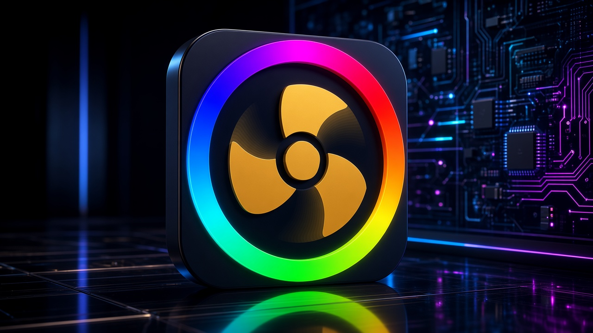
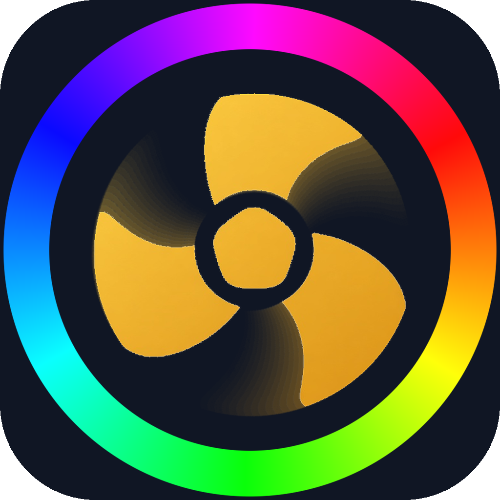
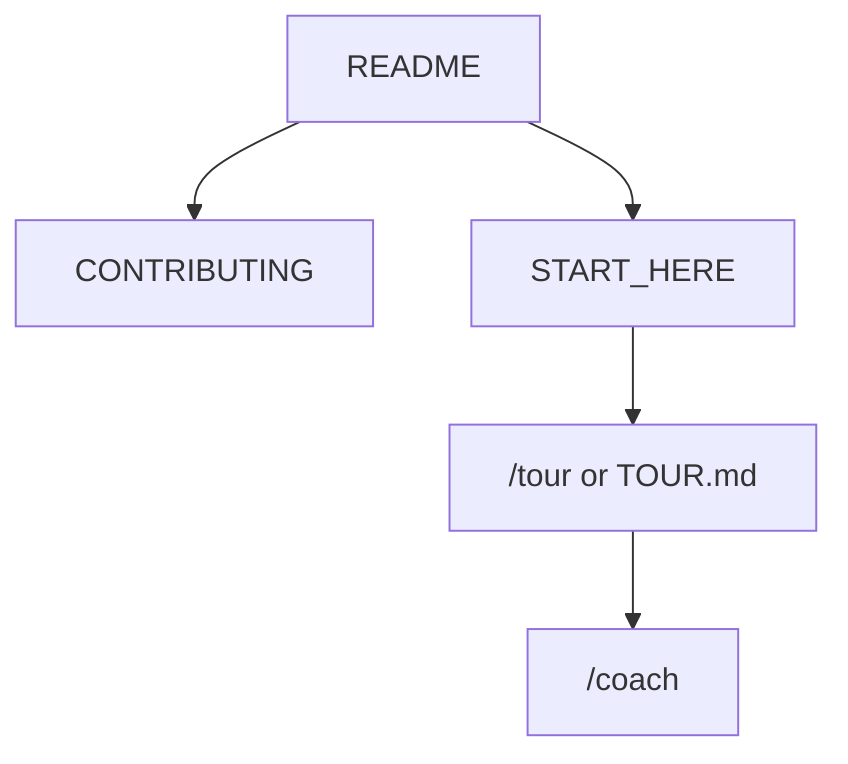

<!-- GENERATED by scripts/generate-project-readme.py — edit branding/product.json -->

  

<h1 align="center">ChromaFlow</h1>

<strong>Fans, pumps, and lighting — Linux Mint and Windows</strong>

  
  
  
  
  
  
  
  
  
  
  
  
  
  
  
  

  
  

## Pitch

ChromaFlow is a FOSS desktop app for cooling (fans, pumps, AIO) and RGB/LED control on Linux Mint and Windows. It discovers what the OS actually exposes, explains gaps versus closed vendor tools, and never ships kernel modules or runs the GUI as root/elevated.

## Demo

  

> Locked mark: navy rounded square, full-spectrum hue ring, gold three-blade fan with motion trails. Linux panel and Windows taskbar use the color PNG/ICO. The banner above is the photorealistic brand shot (glass floor, neon glow, circuitry wall).

> GitHub Pages demo for the `examples/web` Golden Path (not the desktop app): [https://edwardlthompson.github.io/chromaflow/](https://edwardlthompson.github.io/chromaflow/). Add product screenshots under `docs/images/` when available.

## Features

- Inventory of hwmon / SuperIO, HID RGB, optional liquidctl, and a localhost lighting SDK probe
- Support page: curated install checklist (polkit on Linux; PawnIO + LPC helper on Windows)
- Never bundles .ko files; never modprobe names that are not on the YAML allowlist
- GUI and CLI refuse to run elevated; PWM duty uses a watchdog daemon and a firmware failsafe (never silent 0%)
- Warns when CoolerControl, Fan Control, EasyTune, or similar controllers already own the bus

## Supported hardware (by OS)

| Controller / path | Linux Mint | Windows | Notes |
|-------------------|------------|---------|-------|
| ITE / Nuvoton SuperIO PWM (IT8689, IT87952, …) | Tested via hwmon + frankcrawford `it87-dkms` | Tested via PawnIO + `chromaflow-lpc` on Gigabyte X570S | Empty probe stays honest — no fake headers |
| NVIDIA GPU fans (`nvidia-settings`) | Tested (hybrid 4090) | Untested on this port | Needs DISPLAY / Coolbits on Linux |
| OpenRGB SDK localhost | Tested | Partial (private engine sibling) | `127.0.0.1:6742` only |
| Keychron VIA HID | Tested | Untested | Native HID path |
| SteelSeries Arena / Prime HID | Tested | Untested | Research leftovers stay read-only |
| Gigabyte Fusion HID / liquidctl AIO | Tested | Untested | USB claim can empty hidraw |
| AMD `amdgpu` hwmon PWM | Untested (this host is NVIDIA) | N/A | YAML allowlist only |
| ASUS Armoury / Corsair iCUE exclusive HID | Conflict warning | Conflict warning | Quit competing apps first |

Plainly **untested** on Windows today: Keychron, Arena/Prime, Fusion/liquidctl, and NVIDIA fan take-over. Lab hardware sign-off for those rows is still open — see `docs/HARDWARE.md` and `docs/features/windows-desktop.md`.

## Quick start

1. Install Rust (stable) and Node 22. On Windows also install WebView2 + VS Build Tools (see `docs/WINDOWS_DEV.md`). Then `cargo test --workspace --exclude chromaflow-desktop` and `cd apps/desktop && npm ci`.
2. Run `cargo run -p chromaflow-cli -- sensors`. On Linux: `bash scripts/install-support.sh --dry-run`. On Windows: `cargo run -p chromaflow-cli -- support`.
3. Missing fans or LEDs: open the Support tab. On Linux, Install detection support + rescan (log out after udev/group changes). On Windows, install the NSIS package and enable `chromaflowd` for LPC PWM (ADR-0022).
4. Read `NOTICE`, `docs/HARDWARE.md`, `docs/WINDOWS_DEV.md`, and `docs/SUPPORT-SCRIPT.md` before enabling experimental modules.

## For humans

Start with this README, then [`CONTRIBUTING.md`](CONTRIBUTING.md) and [`docs/BEST_PRACTICES.md`](docs/BEST_PRACTICES.md). The first-month playbook is [`docs/FIRST_30_DAYS.md`](docs/FIRST_30_DAYS.md).

## For agents

Read [`docs/START_HERE.md`](docs/START_HERE.md) and [`AGENTS.md`](AGENTS.md). In Cursor type `/tour` or `/bootstrap`. Any other IDE: ask the agent to read [`docs/help/TOUR.md`](docs/help/TOUR.md). `/coach` is the next recommended action.

## Install

Primary targets are Linux Mint 21/22 (Cinnamon) and Windows 10/11 x64. We do not ship kernel modules. Inventory (`chromaflow sensors|devices|rescan`) works offline as an unprivileged user. Linux package: `bash scripts/build-chromaflow-deb.sh` then `sudo dpkg -i target/deb/chromaflow_1.0.0_amd64.deb`. Windows: NSIS via `scripts/build-chromaflow-nsis.ps1` / GitHub Release `ChromaFlow_*_x64-setup.exe` (arm64 row reserved). After udev or group changes (i2c, plugdev), log out on Linux.

## Usage

Do not run the GUI or `chromaflow` elevated. Use Support → Install for modules/udev (polkit) or PawnIO/LPC (Windows). Never set PWM to 0% without an explicit confirm — the watchdog failsafe restores motherboard firmware control if the app or daemon stops. If CoolerControl or Fan Control is already running, ChromaFlow warns and does not take over. Config: `~/.config/chromaflow/` (Linux) or `%APPDATA%\chromaflow` (Windows).

## Configuration

Copy [`.env.example`](.env.example) to `.env` for local secrets (never commit `.env`). Stack-specific config lives in the active `examples/` or app root after prune.

## Contributing

See [`CONTRIBUTING.md`](CONTRIBUTING.md). Prefer small PRs; follow Conventional Commits and the BUILD_PLAN labels (`AGENT` / `HUMAN` / `ADB` / `AUTO`). Status markers: 🔲 open · ✅ done · ❌ blocked.

## Security

See [`SECURITY.md`](SECURITY.md). Enable Dependabot alerts and follow [`docs/SECURITY_TRIAGE.md`](docs/SECURITY_TRIAGE.md) for weekly CVE triage.

## License

[GPL-3.0-or-later](LICENSE) — see the license file for terms.

## Acknowledgments

Scaffolded with [agent-project-bootstrap](https://github.com/edwardlthompson/agent-project-bootstrap). Brand assets: [`branding/BRANDING.md`](branding/BRANDING.md). Design system: [`docs/DESIGN_GUIDE.md`](docs/DESIGN_GUIDE.md).

## What this is not

- A finished commercial product promise
- A place for secrets or production credentials
- An unbounded scope — see README goals above

